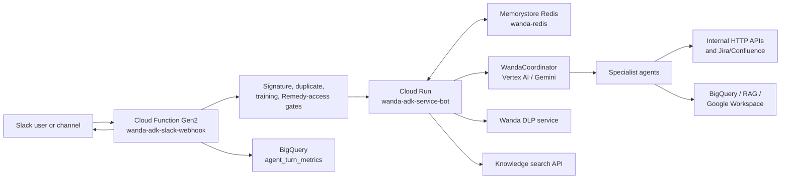

# Wanda Production Architecture

## Scope and Evidence

This document records the deployed architecture of the Wanda chatbot in the production GCP project, `pccw-internal-virtual-agent`, as inspected on 2026-09-25. It covers the Slack path, ADK application, specialist agents, state, data dependencies, security controls, operations, and known risks.

Evidence levels:

- **Verified - GCP configuration**: read from the live production resource configuration.
- **Verified - deployed source**: read from the current Cloud Run or Cloud Functions source archive.
- **Repository evidence**: read from this workspace.
- **Planned**: described in the Wanda 4.0 workshop backlog; not treated as deployed.

The application source currently deployed to Cloud Run is stored in GCP source archives, not in this repository. The repository contains supporting BigQuery definitions and analytics SQL, plus a short ADK API note at [KnowledgeBase/wandaconnect.txt](wandaconnect.txt).

## System Summary

Wanda is an internal Slack chatbot. A public HTTP Cloud Function receives and verifies Slack events, applies access gates, forwards accepted messages to a public Google ADK API service, and posts streamed or buffered results back to Slack. The ADK service uses Vertex AI and a central coordinator to route requests to specialized agents. Redis holds session state. The agents access internal APIs, BigQuery datasets, a knowledge-search service, and Google Workspace integrations through the production VPC.

## Production Entry Points

### Slack webhook

- **Resource**: `wanda-adk-slack-webhook`.
- **Type/runtime**: Cloud Functions Gen2 HTTP function backed by Cloud Run; Node.js 22.
- **Region**: `europe-west2`.
- **Ingress and IAM**: public ingress and `roles/run.invoker` granted to `allUsers`. The function must therefore rely on Slack request-signature verification in application code rather than IAM for caller authentication.
- **Scale/runtime**: minimum one instance, maximum 100, concurrency one, 1 CPU, 2 GB memory, 300-second timeout, startup CPU boost enabled.
- **Network**: VPC connector `eu-prod-wanda-vpc-conn`, all-traffic egress.
- **Keep-warm**: Cloud Scheduler job `wanda-webhook-keep-warm` calls `/health` every minute.
- **Source-verified responsibilities**:
  - receives Slack events and interactive work;
  - de-duplicates normalized user messages;
  - performs training and Remedy access checks before invoking ADK;
  - starts progress/idle messages while ADK work is running;
  - calls buffered `/run` or streaming `/run_sse` on the ADK service;
  - chunks Slack output to 2,800 characters, preserves thread replies, and avoids duplicate streamed and buffered delivery;
  - posts feedback controls and disclaimer text;
  - records agent-turn metrics.

### ADK API

- **Resource**: `wanda-adk-service-bot`.
- **Type/runtime**: Cloud Run service running a Python FastAPI application built with Google ADK.
- **Region**: `europe-west2`.
- **Public URL**: `https://wanda-adk-service-bot-370161436243.europe-west2.run.app`.
- **Ingress and IAM**: public ingress and `roles/run.invoker` granted to `allUsers`.
- **Current live revision**: `wanda-adk-service-bot-00219-2v2`, receiving 100% traffic at the inspection time.
- **Candidate revision**: an older revision is retained with the `candidate` traffic tag and no production traffic.
- **Runtime**: minimum one instance, maximum 100, concurrency 20, 1 CPU, 2 GiB memory, 300-second timeout, startup CPU boost, CPU throttling when idle.
- **Network**: attached to `eu-prod-wanda-vpc` and `eu-prod-wanda-func-subnet`, with all-traffic egress.
- **Service identity**: the default Compute Engine service account, `370161436243-compute@developer.gserviceaccount.com`.
- **Build provenance**: deployed through Cloud Build from a GCS source archive. The current build completed successfully on 2026-09-25.
- **Keep-warm**: Cloud Scheduler job `wanda-adk-service-keep-warm` calls `/health` every minute.

The FastAPI application is created with `google.adk.cli.fast_api.get_fast_api_app`. It exposes ADK application/session endpoints for app `wanda_chatbot`; the checked-in API note shows session creation followed by `/run` calls. The web interface is disabled in production.

## Slack Request Flow

1. Slack delivers an event to the public webhook URL.
2. The webhook validates the Slack request using a signing secret held in Secret Manager.
3. It ignores bot-originated/self messages and de-duplicates messages using a normalized text key.
4. It looks up the Slack user and applies the training gate.
5. For Remedy-related requests, it can also validate the user through the Helix Remedy profile-status API.
6. The webhook creates or reuses an ADK session using the Slack user and conversation/thread context. The ADK session state includes `platform: slack` and the Slack chat-interface type.
7. It sends the user message to `/run` by default. `/run_sse` is available behind the `ADK_USE_SSE` feature flag.
8. While waiting, it posts temporary Slack progress updates. Streaming responses can arrive for up to two extra minutes after the normal response window to support long multi-intent ticket work.
9. It prioritizes ADK `show_wait_message` and `finalize_for_platform` tool outputs, chunks them for Slack, de-duplicates them, and posts final responses to the direct message or the originating thread.
10. It writes per-turn telemetry to `pccw-internal-virtual-agent.wanda_ds.agent_turn_metrics`.

## Access Gates and Safety Controls

### Training gate

The webhook queries `pccw-internal-virtual-agent.wanda_ds.TrainingData`. Access is granted when the Slack user matches a completion record by:

1. exact normalized email;
2. the email local part; or
3. normalized first-name and last-name fallback.

Users who do not pass are blocked before ADK invocation and receive the training completion message. If the table is not configured, the source code allows access; production does configure it.

### Remedy access gate

The webhook has a separate Helix/Remedy profile-status integration, configured with Auth0 credentials held in Secret Manager and the internal Helix API. It also has production BigQuery user-list tables configured for allow-list support.

### DLP and redaction

The ADK service routes content through `wanda-dlp-service`. Its source includes a DLP scan tool with a cached BigQuery-backed exemption list:

- source table: `pccw-internal-virtual-agent.wanda_ds.dlp_redaction_allowlist`;
- configured location: `europe-west2`;
- cache TTL: 300 seconds;
- behavior: preserve approved static values, scan remaining text remotely, then restore approved values.

This is a request-time protection layer. It does not replace authorization on the underlying APIs or datasets.

### Secrets

Secrets are injected from Secret Manager, not stored as Cloud Run environment plaintext. They include Slack credentials, Jira and Confluence credentials, a Gemini key, Helix OAuth credentials, and a Google authorization token. Secret values were not read for this research.

## Session and State Management

### Redis session backend

- **Instance**: `wanda-redis`.
- **Service**: Memorystore for Redis, Basic tier, 1 GB.
- **Addressing**: direct peering on `eu-prod-wanda-vpc`; endpoint `10.94.10.219:6379`.
- **ADK URI**: `redis://10.94.10.219:6379/0`.
- **Key format**: `adk-session:wanda-adk:<app_name>:<user_id>:<session_id>`.

The custom `RedisSessionService` serializes the ADK session state and event history as JSON. It uses short connect/read timeouts and caches the session in the process. If Redis is unavailable, it switches to in-memory state for that service instance and logs a warning. That fallback preserves availability for a warm instance but loses cross-instance continuity and durable session state.

The application also contains an idempotent database-session adapter with stale-session retries, but the live configuration selects Redis rather than Cloud SQL or another SQL backend.

## ADK Orchestration

### Root coordinator

The ADK root agent is `WandaCoordinator`, defined by `wanda_chatbot.agent.root_agent`. It uses Vertex AI (`GOOGLE_GENAI_USE_VERTEXAI=TRUE`) with Gemini `gemini-3.6-flash` in the current production configuration.

The coordinator handles simple greetings directly and uses deterministic pattern routing before the model callback runs. It can queue multiple independent specialists, but executes them sequentially and tracks pending, active, completed, and finalized work in the session. It also owns Google Docs export follow-ups and response finalization.

### Specialist agents

| Agent | Primary role | Backing systems |
| --- | --- | --- |
| `RemedyTicket` | Direct Remedy incident lookup | Remedy/Helix API |
| `JiraAgent` | Direct Jira issue lookup | Jira REST API |
| `CableEvent` | Cable outage and fault-data questions | Cable event API and BigQuery cable data |
| `DocumentAgent` | Analysis of Slack-attached files | Document processing API/service |
| `KMSAgent` | Internal Confluence/wiki/knowledge questions | Knowledge Search API, indexed RAG, BigQuery vector search, optional Confluence fallback |
| `TicketAnalysisAgent` | TicketMaster/SHRPeople analytics, derived ticket fields, RCA/RFO, aggregates, HubSpot feedback | BigQuery, conversational analytics data agent, Jira context |

### Routing rules

The coordinator source implements these high-level rules:

- An attached Slack file owns the turn: route to `DocumentAgent`.
- Internal documentation, Confluence, wiki, short ambiguous internal terms, and acronyms route to `KMSAgent` before answering from model knowledge.
- Cable/outage requests route to `CableEvent`.
- Jira keys normally route to `JiraAgent`.
- Remedy incident identifiers and ticket analysis requests normally route to `TicketAnalysisAgent`; `RemedyTicket` remains available for direct/raw lookup behavior.
- RCA, post-incident, 5-Whys, derived ticket fields, TicketMaster/SHRPeople fields, HubSpot feedback, NPS, multi-ticket, circuit, MTTR, and other analytics requests route to `TicketAnalysisAgent`.
- Independent requests for two or more domains are queued and processed in order, not in parallel.
- The coordinator declines prohibited content and focuses users back on supported work domains.

The coordinator invokes `finalize_for_platform` for a user-safe response. Slack formatting is preserved; voice output strips Slack-oriented markup. It also supports exporting a finalized response to Google Docs when explicitly requested, including optional sharing to a supplied email address.

## Data and Integration Dependencies

### Internal services

The ADK service is configured to call these internal or serverless endpoints:

- cable event agent API;
- Remedy ticket API;
- document agent API;
- Wanda DLP service;
- `knowledge-search-api` Cloud Run service;
- Jira and Confluence SaaS APIs;
- a GSO conversational analytics/data agent hosted in the UAT project.

The scheduler `knowledge-ingestion-automatic-update` calls the knowledge-search service daily at midnight. This supports the indexed knowledge path used by `KMSAgent`.

### BigQuery

Known production data dependencies include:

- `wanda_ds.TrainingData` for Slack-user training authorization;
- `wanda_ds.agent_turn_metrics` for webhook turn telemetry;
- `wanda_ds.dlp_redaction_allowlist` for dynamic redaction exceptions;
- `wanda_ds.TicketMaster` for ticket analytics;
- `wanda_ds.wanda_knowledge_chunk_embeddings` for RAG knowledge chunks;
- `SubCableEvents.cable_fault_replica` for cable-event data;
- `GSO.SHRPeople` for customer/person relationships;
- `BMC.UserList` and `BMC.UserListCleaned` for Remedy-related authorization support;
- `LookerStudio.CCAI_Dialogflow` for conversation transcripts, feedback, timing, and sentiment analytics.

The repository contains production SQL that transforms transcript data into Wanda performance analysis. It detects system-error text, negative sentiment, long duration, and high-turn conversations, then uses BigQuery AI generation to classify intent, outcome, failure type, knowledge gaps, and recommended action. It also contains an executive-report SQL definition.

### Google Workspace output

The coordinator can export a completed response as a Google Doc. The repository contains a UAT `wanda_docs` table design to register generated workspace files with creator, conversation, request, prompt, status, and metadata. The deployed service has a Google authorization-token secret and configured RCA template/header assets. Production persistence of the `wanda_docs` registry was not independently verified.

## Deployment and Operations

### Build and release model

- The ADK service is built from a GCS source archive into Artifact Registry repository `cloud-run-source-deploy` and deployed to Cloud Run.
- The Slack webhook is built as a Gen2 Cloud Function artifact and deployed as its backing Cloud Run service.
- Both services have minimum instance one and one-minute health checks, trading cost for lower cold-start latency.
- The ADK service retains a tagged candidate revision for controlled testing.
- The current build source is outside this Git workspace, creating a source-of-truth split between deployed code and repository code.

### Scheduled work

| Job | Schedule | Purpose |
| --- | --- | --- |
| `wanda-adk-service-keep-warm` | every minute | Health request to ADK API |
| `wanda-webhook-keep-warm` | every minute | Health request to Slack webhook |
| `knowledge-ingestion-automatic-update` | daily, 00:00 | Refreshes Confluence knowledge-search updates |
| `wanda-eval-weekly-prod` | Monday, 08:00 | Runs weekly Wanda evaluation job |
| `Execute-CCAI-Insight-Analysis-workflow` | every six hours | Runs conversation-analysis workload |

### Monitoring and analytics

- Webhook turn telemetry goes to `wanda_ds.agent_turn_metrics`.
- Conversation transcript analytics are based on `LookerStudio.CCAI_Dialogflow`.
- The repository's analysis SQL identifies friction from system errors, sentiment, conversation length, and turn count, then classifies technical/backend versus conversational/LLM failures.
- The deployed code has profiling hooks for specialist stages. Detailed alert policies and SLOs for the Wanda services were not independently verified in this review.

## Risks and Gaps

1. **Public endpoints**: both the Slack webhook and ADK service accept public invocation. Slack signature validation protects the webhook, but the ADK service itself has no Cloud Run IAM barrier. Its API contract should be treated as internet-reachable.
2. **Broad default service account**: both services run as the default Compute Engine service account rather than dedicated least-privilege runtime identities.
3. **Session degradation**: Redis failures cause an in-memory fallback. This avoids an immediate outage but breaks durable, cross-instance conversation continuity.
4. **Source-of-truth split**: production source is retained in GCS deployment archives rather than this repository. The checked-in Wanda material is incomplete and may not match production.
5. **Credential artifact exposure**: the current ADK deployment source archive includes token-named files. Their contents were not opened. Those files should be removed from build context and access/rotation assessed.
6. **No verified per-user data authorization in ADK**: the Slack training gate and Remedy user-status checks are present, but the ADK service uses a service identity for data/API access. Per-user BigQuery row-level authorization or identity propagation was not found in the deployed configuration inspected.
7. **Potential cross-environment dependency**: the production ADK service invokes a GSO conversational analytics agent in the UAT project. The availability, IAM boundary, and data residency implications should be explicitly owned.
8. **DLP exemption governance**: the dynamic allowlist is operationally convenient but needs owner, review cadence, audit trail, and expiry rules.
9. **Health-check dependency**: two one-minute scheduler jobs maintain warm instances. This is intentional latency optimization but should be monitored for job failure and cost.

## Wanda 4.0: Planned, Not Deployed

`Temp/wanda4.md` is a September 2026 workshop backlog, not a statement of the current architecture. It proposes:

- decomposing the sequential coordinator into standalone agent microservices and A2A endpoints;
- a concierge fast path, planner checklist, evaluator, and consolidator;
- parallel as well as sequential execution;
- Cloud SQL main/sub-session tracking and latency analytics;
- JumpCloud and Permit.io identity/policy enforcement;
- production BigQuery migration and UAT snapshot replication;
- KMS migration to Cloud SQL PostgreSQL with `pgvector`;
- migration of source repositories and CI/CD to the corporate Beehive GitHub environment.

The production system inspected for this document is still a Cloud Run ADK monolith with in-process specialist agents and Redis session storage. The 4.0 items should be managed as roadmap work until independently verified after deployment.

## Research Notes

- Research was read-only except for one accidental control-plane side effect: running `gcloud sql instances list` prompted to enable `sqladmin.googleapis.com`, and the CLI enabled that API in `pccw-internal-virtual-agent`. No other resource was intentionally changed.
- No secret values, OAuth token contents, customer records, or conversation contents were read or copied into this document.
- The exact GCP configuration, source archive, and revision information above are point-in-time facts from 2026-09-25 and should be revalidated before an operational change.