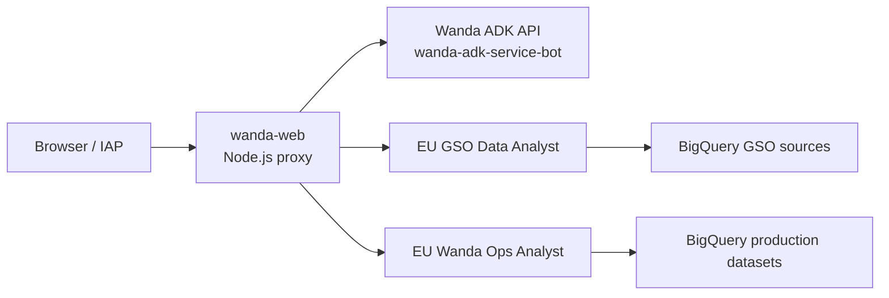

# Wanda Web Architecture

## Scope

This document describes the deployed UAT web application as of 2026-08-25.
It is the authoritative guide for the `wanda-web` Cloud Run service. Do not
confuse it with `wanda-adk-service-bot`, which is Wanda's separate ADK API, or
with the Slack webhook services.

| Item | UAT value |
|---|---|
| Project | `pccw-internal-virt-agent-uat` |
| Cloud Run service | `wanda-web` |
| Cloud Run region | `europe-west2` |
| Runtime service account | `pccw-internal-virt-agent-uat@appspot.gserviceaccount.com` |
| Browser URL | `https://wanda-web-14417857267.europe-west2.run.app` |
| Access control | IAP enabled |

## Components



The service has four responsibilities:

1. Serves the single-page AI Hub interface.
2. Proxies same-origin `/api/wanda/*` calls to the Wanda ADK API.
3. Proxies streamed analyst calls from `/api/data-agent/chat/stream` to the
	Conversational Analytics API and relays browser-safe SSE events.
4. Obtains runtime credentials from the Cloud Run metadata server. The browser
	never receives Google access tokens.

## EU Conversational Analytics Agents

All analyst calls must use the EU multi-region endpoint. A resource location
and its API endpoint must match.

| UI area | Agent resource | Endpoint |
|---|---|---|
| GSO Performance | `projects/pccw-internal-virt-agent-uat/locations/eu/dataAgents/gso-center-operations-data-analyst-eu` | `https://geminidataanalytics.eu.rep.googleapis.com` |
| Wanda Performance | `projects/pccw-internal-virt-agent-uat/locations/eu/dataAgents/agent_c29569c9-7e25-436a-9bb3-218e58e093d6` | `https://geminidataanalytics.eu.rep.googleapis.com` |

The original global GSO agent remains available only as rollback:

```text
projects/pccw-internal-virt-agent-uat/locations/global/dataAgents/gso-center-operations-data-analayst
```

Do not point an EU agent at `https://geminidataanalytics.googleapis.com`.
The API rejects the request because the global endpoint and `locations/eu` do
not match.

## Analyst Request Protocol

The browser sends a same-origin request with an agent selector:

```json
{
  "agentKey": "wandaOps",
  "message": "Show top 5 fallback queries from this week",
  "conversationName": "projects/.../locations/eu/conversations/..."
}
```

The proxy creates a conversation when `conversationName` is empty, then calls
the regional `:chat` endpoint with a stateful `conversationReference`:

```json
{
  "messages": [{ "userMessage": { "text": "..." } }],
  "conversationReference": {
	 "conversation": "projects/.../locations/eu/conversations/...",
	 "dataAgentContext": {
		"dataAgent": "projects/.../locations/eu/dataAgents/...",
		"contextVersion": "PUBLISHED"
	 }
  }
}
```

The upstream API streams a JSON array over chunked HTTP. The proxy incrementally
parses complete JSON objects and emits browser SSE events: `status`, `answer`,
`table`, `chart`, `followups`, `complete`, and `error`.

Never expose raw `THOUGHT`, generated code, planner reasoning, or BigQuery SQL
to end users. Convert them to safe statuses such as “Analyzing your question”
or “Retrieving data”. Forward `FINAL_RESPONSE`, table rows, chart Vega configs,
and follow-up questions only.

The proxy includes `complete.finalAnswer` as a fallback for valid final text
received earlier in the stream. The frontend must not duplicate it after already
rendering `answer` events.

## Tables, Charts, and UI

The analyst response can include:

- `systemMessage.text` with `FINAL_RESPONSE` or `FOLLOWUP_QUESTIONS`.
- `systemMessage.data.result` with `schema.fields` and `data` rows.
- `systemMessage.chart.result.vegaConfig` with a Vega-Lite chart definition.

The frontend renders data rows as an HTML table and renders Vega-Lite charts
with `vega-embed`. Keep tables HTML-escaped and cap the number of forwarded rows
to prevent oversized responses. The two analyst panels support independent,
persisted widths via browser local storage.

## Required IAM

The Cloud Run runtime identity is the principal that queries data, not the
browser user and not the developer running `gcloud` locally.

### Agent access

Grant the runtime service account this role on each data agent:

```text
roles/geminidataanalytics.dataAgentUser
member: serviceAccount:pccw-internal-virt-agent-uat@appspot.gserviceaccount.com
```

### BigQuery access for Wanda Ops Analyst

Wanda Ops queries data in the production project
`pccw-internal-virtual-agent`. The UAT runtime service account needs:

| Scope | Required access |
|---|---|
| Project `pccw-internal-virtual-agent` | `roles/bigquery.jobUser` |
| Dataset `AgentDataset` | BigQuery `READER` |
| Dataset `LookerStudio` | BigQuery `READER` |

Missing `LookerStudio` access causes a deceptive symptom: the Ops stream emits
planning statuses only and completes without a final answer. BigQuery audit logs
show `Access Denied` for
`pccw-internal-virtual-agent:LookerStudio.CCAI_Dialogflow`.

### BigQuery access for GSO

Validate the datasets referenced by the EU GSO agent independently. Do not
assume project-level UAT roles grant access to production-project data.

## Troubleshooting Checklist

1. Confirm `wanda-web` is on its intended revision and receives 100% traffic.
2. Confirm the agent resource location is `eu` and the endpoint is
	`geminidataanalytics.eu.rep.googleapis.com`.
3. Directly test a new conversation with the data agent before changing UI code.
4. Inspect BigQuery audit logs in each source-data project for the Cloud Run
	runtime service account. Look for table-level `Access Denied` errors.
5. Verify both `bigquery.jobUser` and dataset `READER` grants for every dataset
	the agent can query.
6. Use a fresh browser conversation after an IAM change. Old chat bubbles are
	historical and do not prove a current request still fails.
7. Test the actual page through IAP when possible. Direct public HTTP requests
	redirect to Google sign-in and do not exercise the application.
